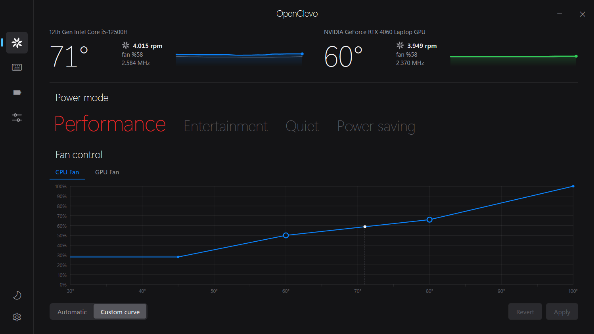
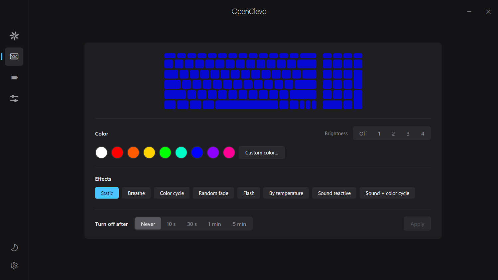
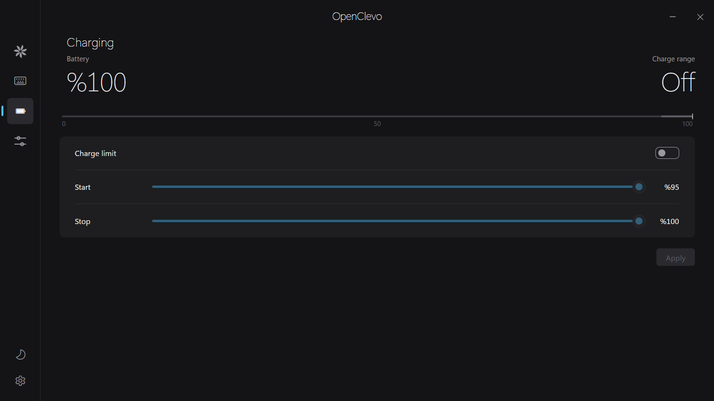
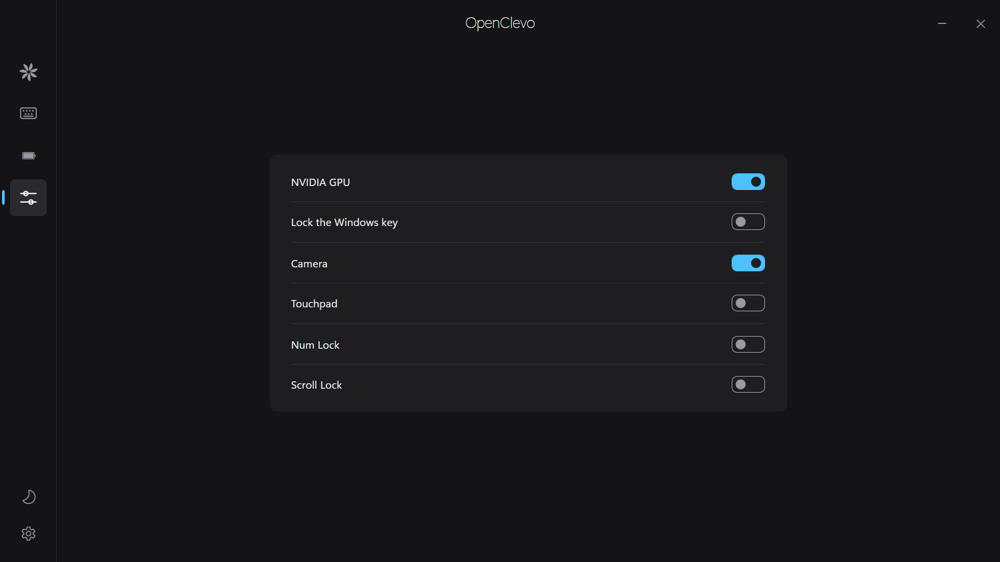
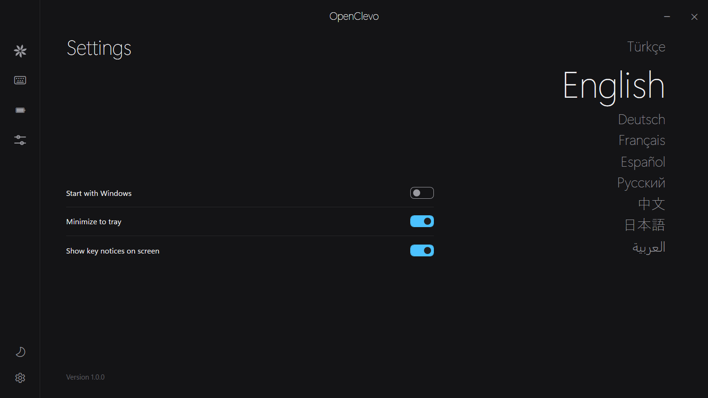

<div align="center">


# OpenClevo

**Open-source control for Clevo laptops.**<br>
Fan curves, power modes, keyboard backlight and battery charge limit in one small, modern app, with no Clevo Control Center needed.

[](https://github.com/yigityanik/OpenClevo/releases)
[](https://github.com/yigityanik/OpenClevo/releases)


[**Download**](https://github.com/yigityanik/OpenClevo/releases/latest) · [Features](#features) · [Install](#install) · [Build](#build-from-source)

<br>

<picture>
  <source media="(prefers-color-scheme: light)" srcset="assets/screenshots/fans-light.png">
  
</picture>

</div>

<br>

## Why OpenClevo

Clevo Control Center is a large package. OpenClevo does the everyday jobs with a clean interface, and it is small: about **10 MB of RAM** while it sits in the tray and about **90 MB** with the window open. Everything runs locally: there is no account, and the app makes no network connections at all.

## Features

### Fans and power

Pick a power mode (Performance, Entertainment, Quiet, Power saving) and shape the fan behaviour of the CPU and GPU fans with a drag-and-drop curve. Live temperature, fan speed and clock for both chips are always in view. When you switch to Power saving, OpenClevo can also turn the NVIDIA GPU off for you.

### Keyboard backlight

<picture>
  <source media="(prefers-color-scheme: light)" srcset="assets/screenshots/keyboard-light.png">
  
</picture>

Static colours (nine presets plus a custom colour), four brightness levels, and effects that go beyond the firmware's own: breathe, colour cycle, random fade, flash, **by CPU temperature**, **sound reactive** and sound with colour cycle. The backlight can turn itself off after you stop typing.

### Battery



Set a charge range (start and stop percentage) to keep the battery healthy when the laptop stays plugged in (FlexiCharger).

### System switches



Switch the NVIDIA GPU, lock the Windows key, turn the camera off in firmware, disable the touchpad, and see Num Lock and Scroll Lock, all from one list.

### Fn keys with on-screen notices

The camera and touchpad Fn keys work without Clevo's software, and OpenClevo shows a small notice on screen when you press them. Caps Lock and Num Lock get the same notice. The switches in the app follow the keys live. You can turn the notices off in the settings.

### Details

- Light and dark theme: follows Windows, or choose with the sun/moon button
- **9 languages:** English, Türkçe, Deutsch, Français, Español, Русский, 中文, 日本語, العربية (with right-to-left layout)
- Starts with Windows, lives in the tray, opens on the fan page
- Esc steps back: settings, then the fan page
- No .NET runtime to install: it is self-contained

<details>
<summary>Settings page</summary>
<br>

</details>

## Install

1. Download `OpenClevo-Beta-1.0.0-x64-windows.zip` from the [latest release](https://github.com/yigityanik/OpenClevo/releases/latest).
2. Extract it and run **`OpenClevo-Setup.exe`**. It asks for administrator rights because it installs the driver.
3. Open **OpenClevo** from the Start menu.

The installer sets up everything, including the **Acpi Bridge driver** that OpenClevo uses to talk to the laptop's firmware. If you had Clevo Control Center installed, you can remove it first.

To remove OpenClevo, use **Settings → Apps → Installed apps → OpenClevo**.

<details>
<summary>Check the download</summary>
<br>

PowerShell:

```powershell
Get-FileHash .\OpenClevo-Beta-1.0.0-x64-windows.zip -Algorithm SHA256
```

Expected SHA-256:

```
FA941A0C3F32AB27002757A78291A7713FCCF53835C7D30D1B9BF6AD92B9BE4C
```

Windows SmartScreen may warn that the publisher is unknown, because the installer is not code-signed yet. Choose **More info → Run anyway**.
</details>

## Supported laptops

OpenClevo is developed and tested on the **Gigabyte G5 KF** (Clevo NP50RNC2-Y) on Windows 11. It talks to the standard Clevo ACPI interface (`ACPI\CLV0001`), so other Clevo-based laptops may work, but only the G5 KF is verified. Some pages depend on the model: the keyboard page, for example, supports single-zone backlights.

If you try it on another model, please [open an issue](https://github.com/yigityanik/OpenClevo/issues) and tell us what worked and what did not.

## Build from source

You need the [.NET 10 SDK](https://dotnet.microsoft.com/download) on Windows.

```powershell
git clone https://github.com/yigityanik/OpenClevo.git
cd OpenClevo
powershell -ExecutionPolicy Bypass -File .\build-installer.ps1
```

The installer is written to `build\OpenClevo-Setup.exe`.

| Folder | What is in it |
| --- | --- |
| `src/OpenClevo.App` | The app: window, tray, notices |
| `src/OpenClevo.Core` | The driver interface and the Clevo firmware calls |
| `src/OpenClevo.Setup` | The installer |
| `drivers/AcpiBridge` | The Acpi Bridge driver the installer sets up |
| `langs` | The nine language files (JSON) |

Translations are plain JSON files in `langs/`. A fix or a new language is a small pull request.

## Disclaimer

OpenClevo is an independent, unofficial project. It is not affiliated with or endorsed by Clevo or Gigabyte. It changes fan and power settings at the firmware level: use it at your own risk, and keep an eye on temperatures when you create custom fan curves.

## Contributing

Bug reports, translations and tests on other Clevo models are welcome. Open an [issue](https://github.com/yigityanik/OpenClevo/issues) or a pull request.
